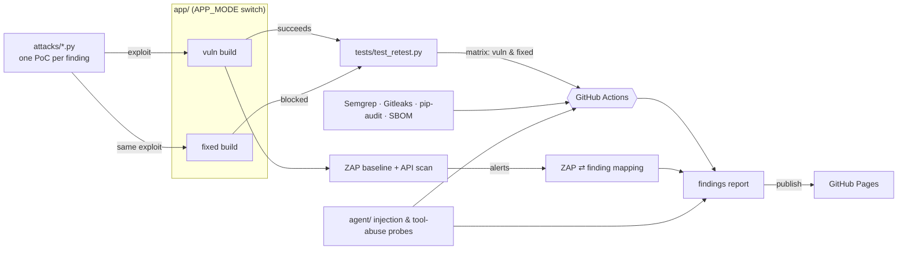

# red-team-appsec-lab

[](https://github.com/hamza2829/red-team-appsec-lab/actions/workflows/ci.yml)
[](https://github.com/hamza2829/red-team-appsec-lab/actions/workflows/security.yml)
[](https://github.com/hamza2829/red-team-appsec-lab/actions/workflows/zap.yml)

A small **offensive-security lab that attacks its own deliberately vulnerable system,
verifies the fixes, and automates security checks** — entirely in GitHub Actions. No
Docker, no API keys, no accounts, no manual steps.

> ## ⚠️ Responsible use
> This repository is **my own test system**. The target app in `app/` contains
> intentional vulnerabilities and a mock AI agent that can be tricked. Everything runs
> against `127.0.0.1` inside CI or your own checkout.
>
> - Do **not** deploy the target or expose it to a network.
> - Do **not** point the attack scripts or ZAP at any system you do not own or are not
>   explicitly authorised to test.
> - The phishing/pretexting material in `docs/exercise/` is **template paperwork only**:
>   a fictional company, `.example` addresses, and no emails are ever sent.
> - Attacking systems without authorization is illegal. Keep it to this lab.

## What's inside

| Area | Path | What it is |
|---|---|---|
| Vulnerable target | `app/` | FastAPI ticketing app + API (JWT & cookie auth, roles) and a mock AI agent with a human-approval step. One switch, `APP_MODE=vuln\|fixed`, toggles every weakness. |
| Attack PoCs | `attacks/` | One reproducible script per finding, each with expected output. |
| Re-test harness | `tests/test_retest.py` | Proves each bug in **vuln** mode and the fix in **fixed** mode; runs as a CI matrix. |
| AI agent tests | `agent/` | Prompt-injection, tool-abuse and boundary tests + a generated report. |
| Secure pipeline | `.github/workflows/security.yml`, `security/` | Gitleaks, Semgrep, pip-audit, CycloneDX SBOM — with a failing and a passing example. |
| ZAP scans | `.github/workflows/zap.yml` | Baseline + OpenAPI API scan, artifacts, and a ZAP→finding mapping. |
| Threat model & review | `docs/threat-model-file-upload.md`, `docs/review-checklist.md` | A STRIDE threat model and checklist applied as a pre-merge gate for a new file-upload feature. |
| Exercise templates | `docs/exercise/` | Authorized phishing/pretext scope & sign-off, debrief, and a fictional sample plan. |
| Findings report | `docs/` → GitHub Pages | Every finding with severity, repro, impact, fix and re-test result. |

## Findings (all have a PoC and a re-test)

| ID | Finding | Severity |
|---|---|---|
| F01 | IDOR on `GET /api/tickets/{id}` | High |
| F02 | SQL injection auth bypass | Critical |
| F03 | Stored XSS on ticket render | High |
| F04 | Weak JWT secret → token forgery (incl. `alg=none`) | Critical |
| F05 | Missing login rate limit | Medium |
| F06 | Security header misconfiguration | Medium |
| F07 | Leaked key in git history | High |
| F08 | Agent tool abuse / scope break | High |
| F09 | Indirect prompt injection + approval bypass | Critical |

Full write-ups: **the published findings report** (GitHub Pages, built by `pages.yml`).

## Attack → re-test flow



The re-test is the heart of the lab: the **same** exploit is run against both builds, so
a passing CI run is proof that the bug was real *and* that the fix holds.

## Run it yourself (optional — CI does all of this)

```bash
python -m venv .venv && . .venv/bin/activate        # Windows: .venv\Scripts\activate
pip install -r requirements.txt

# prove the vulnerabilities
APP_MODE=vuln  python -m pytest -q

# prove the fixes hold
APP_MODE=fixed JWT_SECRET=$(openssl rand -hex 16) python -m pytest -q

# run a single proof of concept
APP_MODE=vuln PYTHONPATH=attacks python attacks/idor.py
```

## Design note

The task asked for a "vulnerable branch" and a "fixed branch". This lab uses a single
`APP_MODE` switch instead of two branches: it keeps one codebase, lets the **same** test
assert both states, and runs cleanly as a CI matrix — which is more reproducible than
diffing branches. The mapping is 1:1 (`vuln` = vulnerable branch, `fixed` = fixed branch).

## License

MIT. For education and authorized testing only.
